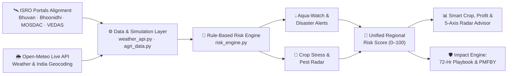

<div align="center">

# 🛰️🌾 Krishi Rakshak
### *Space-to-Soil Agricultural & Disaster Decision Platform*

[](https://github.com/your-username/krishi-rakshak)
[](https://bhuvan.nrsc.gov.in/)
[](https://mosdac.gov.in/)
[](https://python.org)
[](https://your-streamlit-url.streamlit.app)

<br />


*Satellite view of the Indian subcontinent — turning orbital Earth Observation into farm-level protection.*

🔗 **[Live Deployed App](https://your-streamlit-url.streamlit.app)** &nbsp;•&nbsp; 🎬 **[1–2 Min Demo Video](https://your-demo-video-link)** &nbsp;•&nbsp; 📊 **[Pitch Deck (PPT)](./Krishi_Rakshak_Pitch.pptx)**

</div>

---

## 🌍 Executive Summary

Every season, Indian farmers confront two overlapping crises: **sudden climate disasters** (cyclones, hailstorms, droughts, floods, and shrinking reservoirs) and **silent farm-level threats** (early crop stress, regional pest outbreaks, and mismatched sowing choices). While rich Earth Observation data already exists on national portals such as **ISRO Bhuvan, Bhoonidhi, MOSDAC, and VEDAS**, it is distributed across technical GIS interfaces built for scientists rather than farmers.

**Krishi Rakshak** bridges this last-mile gap. It unifies satellite vegetation/water indicators, live weather feeds, and agricultural economics into a single, farmer-friendly decision engine—creating a closed-loop **"Space-to-Wallet"** link that calculates exactly how live satellite risks affect crop survival, profit, and emergency action.

---

## ✨ Key Innovations

1. **💰 Closed-Loop "Space-to-Wallet" Engine:** Mathematically links live satellite disaster and bioclimatic pest risks directly to crop success probability, input budgets, and projected net profit.
2. **⚡ Interactive 72-Hour Survival Playbook:** Goes beyond generic weather warnings by providing crop-specific emergency steps where checking off actions dynamically updates **Estimated Loss Prevented (₹)**.
3. **🛰️ Satellite Change Detection & Pan-India Reach:** Combines Week 1–8 **NDVI/NDWI** time-lapse scrubbing with live geocoding for any city or district across India.
4. **📄 PMFBY Insurance Readiness:** Generates an instant, downloadable **Satellite Damage Evidence Summary** (timestamp, weather peaks, NDVI/NDWI readings, and estimated loss) to accelerate **Pradhan Mantri Fasal Bima Yojana (PMFBY)** claims.

---

## 🧩 Core Modules

| Module | Domain Alignment | Key Capabilities |
| :--- | :--- | :--- |
| **💧 1. Aqua-Watch & Disaster Shield** | 🌪️ Domain 03 (Disaster Management) | Live wind, rainfall, and temperature feed; Week 1–8 **NDWI** water/reservoir time-lapse map; early alerts for Cyclones, Hailstorms, Heavy Rain, Floods, and Droughts. |
| **🌱 2. Crop Stress & Pest Radar** | 🛰️ Domain 02 (Earth Observation) | Week 1–8 **NDVI** vegetation vigor map; explainable bioclimatic rule engine flagging regional pests (Desert Locust, Brown Planthopper, Stem Borer, Fungal Blight). |
| **📊 3. Smart Crop & Profit Advisor** | 👨‍🌾 Farmer Decision Utility | Soil & season crop matching; dynamic success vs. failure probability; care guide; acreage-scaled cost/revenue/profit calculator; **5-Axis Crop Comparison Radar Chart**. |
| **🛡️ 4. Disaster-to-Farm Impact Engine** | 🔄 Domain 02 + Domain 03 Synthesis | Live survival recalculation under disaster scenarios; Loss Without Action vs. Loss After Action chart; interactive 72-hour checklist; downloadable **PMFBY** report. |

---

## 🔬 Scientific Basis: Satellite Indices

Krishi Rakshak aligns its geospatial monitoring with standard multispectral Earth Observation indices:

<div align="center">


*Global satellite NDVI reference illustrating how orbital sensors quantify vegetation vigor across regions.*
</div>

* **🌿 NDVI (Normalized Difference Vegetation Index)** — Detects early crop stress and biomass decline:

$$\text{NDVI} = \frac{\text{NIR} - \text{Red}}{\text{NIR} + \text{Red}}$$

* **🌊 NDWI (Normalized Difference Water Index)** — Monitors reservoir shrinkage, surface water, and flood expansion:

$$\text{NDWI} = \frac{\text{Green} - \text{NIR}}{\text{Green} + \text{NIR}}$$

| Index | Typical Range | 🔴 Low Value Interpretation | 🟢 / 🔵 High Value Interpretation |
| :--- | :--- | :--- | :--- |
| **NDVI** | $-1.0 \text{ to } +1.0$ | Bare soil, severe drought, or stressed crops | Dense, healthy, vigorous vegetation |
| **NDWI** | $-1.0 \text{ to } +1.0$ | Dry soil or shrinking reservoirs (drought risk) | Open water bodies or flood/waterlogging zones |

---

## 🏗️ System Architecture



---

## 📸 Live Prototype Preview

> 💡 *Tip: Drop 2 screenshots of your running Streamlit app into an `assets/` folder (`dashboard_map.png` and `impact_engine.png`) so judges can preview your UI right on GitHub.*

| 🗺️ Aqua-Watch & Time-Lapse Satellite Map | 🛡️ 72-Hour Playbook & Loss Prevented |
| :---: | :---: |
|  |  |

---

## 📁 Repository Structure

```text
krishi-rakshak/
├── .streamlit/
│   └── config.toml        # 🎨 Institutional light-mode Agri-Tech theme
├── assets/                # 📸 App screenshots for README preview
├── app.py                 # 🖥️ Main Streamlit dashboard, sidebar & 4-tab UI
├── map_view.py            # 🗺️ Plotly NDVI/NDWI time-lapse maps & 5-axis crop radar
├── weather_api.py         # 🌦️ Open-Meteo live weather, India geocoding & offline fallback
├── agri_data.py           # 🌾 Regional baselines, pest profiles & crop economics
├── risk_engine.py         # 🧠 Disaster detection, pest rules, financial math & PMFBY generator
├── requirements.txt       # 📦 Python dependencies for local & cloud deployment
└── README.md              # 📖 Project documentation
```

---

## 🚀 Quick Start (Run Locally)

### Prerequisites
* 🐍 Python 3.9 or higher
* 📦 `pip` package manager

### Installation & Launch

1. **Clone the repository:**
   ```bash
   git clone https://github.com/your-username/krishi-rakshak.git
   cd krishi-rakshak
   ```

2. **Install dependencies:**
   ```bash
   pip install -r requirements.txt
   ```

3. **Run the application:**
   ```bash
   streamlit run app.py
   ```
   The dashboard will open automatically at `http://localhost:8501`.

> 🛡️ **Offline Resilience:** If internet connectivity drops during a live demonstration, `weather_api.py` automatically switches to a cached fallback dataset so all maps, calculations, and disaster simulations continue operating smoothly.

---

## 🛠️ Tech Stack & Data Acknowledgments

* **💻 Application Framework:** Python, Streamlit
* **📈 Data Visualization & Mapping:** Plotly (`plotly.express`, `plotly.graph_objects`), OpenStreetMap tiles, Pandas
* **🌦️ Live Meteorological & Geocoding Data:** [Open-Meteo API](https://open-meteo.com/) (free, open-source weather & Indian location geocoding)
* **🛰️ Indian Earth Observation Alignment:** Conceptually aligned with **ISRO Bhuvan**, **Bhoonidhi**, **MOSDAC** (INSAT-3D/3DR/3DS weather products), and **VEDAS** agro-meteorological frameworks.
* **🖼️ Public Domain Satellite Imagery:** NASA / Wikimedia Commons Earth Observation archives.

---

## 👥 Team — Error 404 not found (Team 05)

Built for **ASTRA 2026** *(Domain 02: Earth Observation & Satellite Applications + Domain 03: Space-Based Disaster Management)*.

| Member | Primary Responsibilities |
| :--- | :--- |
| **👨‍💻 Omm Satyaprakash Nayak** | Backend Risk & Impact Engine, Live Weather & Geocoding APIs, Agricultural Dataset, GitHub Management |
| **🎨 Hrugved Sharad Rathode** | Streamlit Dashboard UI, Interactive NDVI/NDWI Maps & Crop Radar, Cloud Deployment, Demo & Presentation |

---

<div align="center">
  <b>🛰️ From Space to Soil — Protecting Indian Farmers Before Disaster Strikes 🌾</b>
</div>